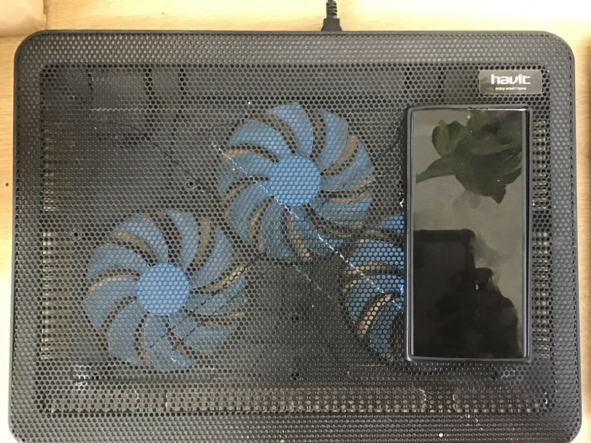

# Phase 0b results — phone accelerometer session, 20 November 2026

**Data origin:** `phone`. All captures are real measurements from the Galaxy S22 Ultra's built-in accelerometer (phyphox, "Acceleration (with g)"). They are **not** from the product sensor (ADXL355), not synthetic, and not evidence about any industrial machine.

**Raw data:** `data/measured/phone/raw/20261120-2306_phone_*.csv` (15 files).
**Analysis:** `python python/scripts/analyze_phone.py data/measured/phone/raw/*.csv --shaft-hz 23.3`, rerun by Claude in a Linux cloud container on 22 November 2026 against the files at commit `279bca8`. Numbers below come from that run.

## Summary

| Question (from `docs/PHASE0B_PHONE_SESSION.md`) | Answer |
| --- | --- |
| Is the phone's sampling usable? | **Yes.** 420.05–420.11 Hz, jitter ≤ 0.12 %, longest gap 2.4 ms on every capture. |
| Is the fan's 1× peak visible? | **No.** The 1× band (22.3–24.3 Hz) is at the fan-off noise floor on every clean capture. |
| Did the added weight produce a detectable change? | **No.** The change is smaller than the spread from remounting the phone alone. |
| Is mounting a major factor? | **Yes, the dominant one** in this setup (see "Setup" below). |

The session did what Phase 0b is for: it exercised capture, naming, labelling and analysis end to end on real data, and it found the setup problems before any hardware was bought.

## Setup (as recorded)

- **Fan:** Havit HV-F2056 laptop cooling pad, three fans under a perforated metal top. Label: 5 V DC, 2.1 A for the whole pad, 1400 RPM ±10 % (1× ≈ 23.3 Hz, range ≈ 21–26 Hz). 9 blades per fan, so blade-pass ≈ 210 Hz. No tachometer and no speed setting ("high" in file names is the only speed).
- **Phone:** in its case, lying flat on the metal top, partly over the right-hand fan.
- **Captures:** `off`, `baseline`, `remount`, `imbalance-small`, `baseline-after`, three repeats each, 30 s.
- **Deviation from the guide:** the guide said to skip the weight test for this fan. A putty weight was used anyway; `baseline-after` was recorded after removing it.

## Results

Vertical axis (z). Levels are RMS acceleration with the mean removed, in m/s².

| Condition | z RMS (r1, r2, r3) | Strongest z peak, Hz | z kurtosis | 1× band RMS |
| --- | --- | --- | --- | --- |
| off | 0.011, 0.012, 0.009 | 35.5, 34.7, 35.5 | 5.6, 5.3, 3.7 | 0.0013–0.0014 |
| baseline | 0.038, **0.089**, 0.036 | 109.4, 35.9, 67.3 | 2.4, **170.9**, 2.8 | 0.0014, **0.0102**, 0.0014 |
| remount | 0.094, 0.133, 0.118 | 65.1, 67.3, 68.0 | 2.8, 2.0, 2.0 | 0.0015–0.0020 |
| imbalance-small | 0.064, 0.060, 0.115 | 66.6, 66.6, 63.1 | **120.4**, 7.0, **142.8** | 0.0016–0.0024 |
| baseline-after | 0.077, 0.049, 0.036 | 110.7, 116.6, 59.3 | **213.9**, **123.4**, 7.5 | 0.0020–0.0034 |

Bold marks captures with a large spike (kurtosis far above 3). A spike raises the level in every band, so those rows can't be compared on level.

### What the data shows

1. **Sampling is reliable.** The phone's rate and timing are steady enough to trust the spectra up to its 210 Hz limit.
2. **No 1× peak.** On the clean captures, the 1× band reads the same as with the fans off. The one higher value (baseline r2, 0.0102) comes from that capture's spike, not from the fan.
3. **A repeating 63–68 Hz peak with the fans on.** It appears in all three remounts, baseline r3 and the imbalance captures. It does not appear with the fans off.
4. **Mounting dominates.** Remount levels (0.094–0.133) spread wider than the gap between imbalance (0.060–0.115) and baseline (0.036–0.038). By the guide's rule, the weight test is **not a detection**.
5. **Frequent spikes.** 6 of 15 captures have kurtosis above 100, including two `baseline-after` captures with the weight removed. So the spikes are not caused by the weight; likely sources are touches, the table, the pad rattling, or the environment.
6. **Background at about 35 Hz.** Present with the fans off, so it comes from the room (possible sources: neighbour's music, appliances, building). Not identified.

### Likely explanations (not yet tested)

- **The metal top is a thin, flexible panel.** It has its own resonances, and the phone's weight and position change how it moves. This would explain both the strong remount effect and a fixed peak near 65–68 Hz.
- **The 65–68 Hz peak may instead be 3× the shaft speed** (3 × 22.3 Hz ≈ 67 Hz). The tap test below separates the two.
- **Blade-pass (≈ 210 Hz) sits at the phone's Nyquist limit**, so the phone cannot measure it reliably. This is a limit of the phone, not of the method; the ADXL355 (≈ 1 kHz bandwidth) would cover it.
- **The phone sits in a fan's airflow and in its case**: the airflow adds force on the phone, and the case damps and blurs the signal.

## Acceptance criteria (from the session guide)

- [x] Raw files in `data/measured/phone/raw/`, named with `_phone_`, labelled `data_origin: phone`.
- [x] `summary.csv` reports the phone's actual sample rate and jitter.
- [x] 1× peak: **not identified**, with reasons written above.
- [x] Imbalance compared with baseline and with the repeat and remount spread: **not a detection**.
- [x] Remount spread recorded (z RMS 0.094–0.133).
- [ ] Safety: deviation recorded (weight test done on a fan where the guide said to skip it). No incident reported.
- [x] This note.

## Next session (about 1 hour)

1. **Stiff mount:** phone out of its case, on the solid frame edge of the pad, not on the mesh. Tape the outline.
2. **Tap test:** fans off, tap the mesh lightly once during a capture. If 63–68 Hz appears, it's the panel.
3. **One fan at a time** if the pad allows it, three baselines each.
4. **One capture with the phone on the table** beside the pad.
5. **Quiet conditions:** fan-off capture at the start and end; note music, appliances and footsteps for each capture.
6. **No weight test** on this pad.

Tooling follow-up: `analyze_phone.py` reports the 1× level only within ±1 Hz of `--shaft-hz`, which is too narrow for a fan specified at ±10 %. Widen the band or make it a parameter before the next analysis.

## What this does and does not show

It shows the capture-and-analysis method runs end to end on real data, and that the phone is a steady recorder. It does **not** show that the method can detect imbalance, and it says nothing about industrial machines or about the ADXL355. The main lesson is about mounting: a flexible mounting surface can hide the signal of interest, which applies directly to how the real sensor will be attached.
