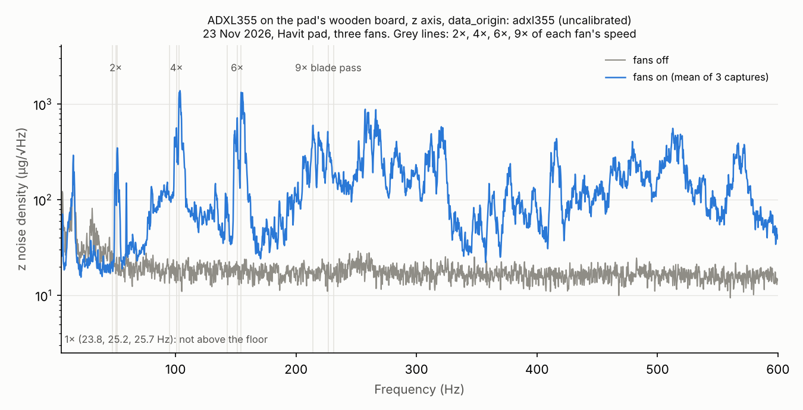
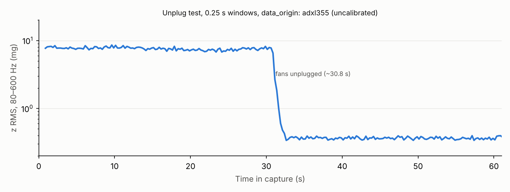
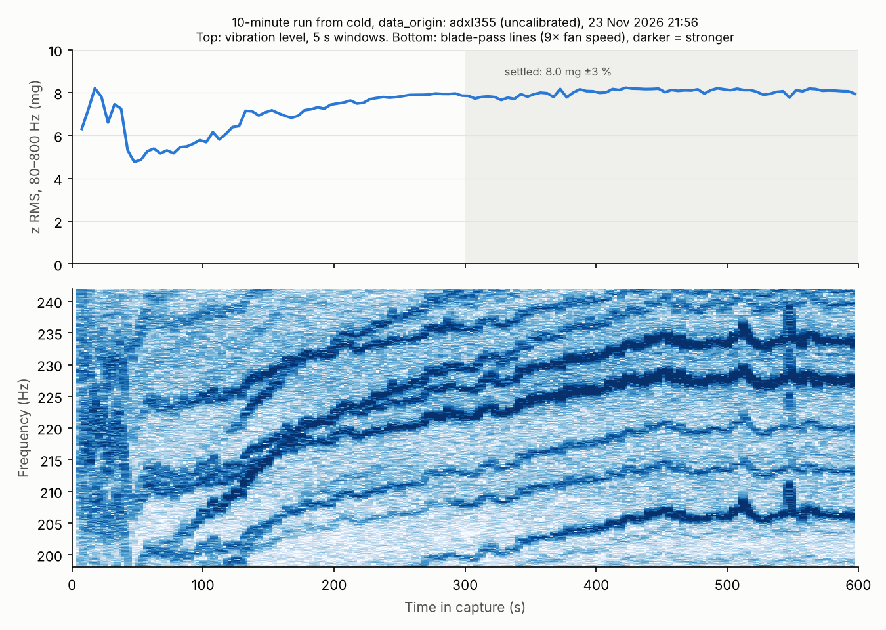

# Phase 1 results — first ADXL355 fan session, 23 November 2026

**Data origin:** `adxl355`. All captures are real measurements from the product sensor (EVAL-ADXL355-PMDZ on the ESP32-S3, step 3 streaming firmware, 4,010 Hz, ±2 g, uncalibrated: values in g are good to about ±8 %). The test object is a USB laptop cooling pad, **not an industrial machine**. Nothing here is evidence of fault detection or predictive maintenance.

**Raw data:** `data/measured/adxl355/raw/20261123-2053…` to `20261123-2100…` (6 files). Captured by Rami 20:53–21:01 America/Toronto with `python/scripts/capture_adxl355.py`.
**Analysis:** run by Claude in a Linux cloud container: `analyze_adxl355.py` for the data-path checks, then Welch spectra (16,384 and 65,536 points; 0.24 and 0.06 Hz resolution) and band RMS with SciPy, using each file's measured output data rate.
**Previous:** phone sessions in `docs/PHASE0B_RESULTS_2026-11-22.md`; sensor at rest in `docs/DEVELOPMENT_SETUP.md` (step 3 record).

## Summary

| Question | Answer |
| --- | --- |
| Did every sample arrive? | **Yes.** 0 missing sets, 0 CRC errors, 0 FIFO overruns, 0 dropped words, 0 SPI errors in all 6 captures, with the longer wires. |
| Can the ADXL355 tell fans on from fans off? | **Yes, clearly.** Unplugging the fans drops z vibration at 80–600 Hz from 7.6 mg to 0.37 mg RMS (about 20×) within about 1.5 s. The phone saw about 1.3× on the same pad. |
| Can it see each fan separately? | **Yes.** Three families of lines, one per fan, at 23.8, 25.2 and 25.7 Hz shaft speed (about 1,430, 1,510 and 1,545 RPM). |
| Is the blade-pass tone visible? | **Yes.** 9× each fan's speed: 214, 227 and 232 Hz. The phone could not see it (its limit was 210 Hz). |
| Is the 1× (once per turn) line visible? | **No.** Same as with the phone. At 23.8–25.7 Hz the fans-on level is no higher than fans-off. |
| Is fans-on vibration steady? | **After about 5 minutes, yes.** From cold the fans speed up by several percent as they warm, so their lines move across the board's resonances and the level changes. From 5 to 10 minutes it holds at 8.0 mg ±3 % (10-minute run below). That explains the 65 % rise in the first session. |

## Setup (as recorded)

- **Fan:** Havit HV-F2056 cooling pad, three fans, one speed, USB power from a power bar.
- **Board:** the pad stands on the bamboo board on rubber corner caps on the desk.
- **Sensor:** EVAL-ADXL355-PMDZ flat on the bamboo board, about 1 cm from the pad's short edge, held down with clear tape over the top; wires anchored with tape on the board (photos at 14:02 and 21:10, the second taken right after the captures). ESP32-S3 on a separate breadboard about 20 cm away on the desk, not touching the board. Mount tag in the file names: `board-beside`.
- **Washing machine:** asked to be off.

| File | What was done |
| --- | --- |
| `2053_off_r1` | Fans unplugged, 30 s. |
| `2056_on_r1` | Fans on, 30 s. A first try; the next file repeats `r1`. Kept, not used in the mean spectrum. |
| `2057_on_r1`, `2058_on_r2`, `2058_on_r3` | Fans on, 30 s each, nothing touched. |
| `2100_unplug-test_r1` | 60 s. Fans on, pad unplugged at about 30.8 s. |
| `2156_warmup_r1` (`.csv.gz`) | 600 s, after the fans had been off for at least 30 minutes. Capture started with the pad unplugged; Rami plugged it in when streaming began (fans start at about 4 s). Stored gzipped (23 MB instead of 61 MB). |

## Data path

| File | Sets | Output data rate | Missing, CRC, overruns, dropped, SPI | Temp |
| --- | --- | --- | --- | --- |
| off r1 | 125,264 | 4009.7 Hz | 0, 0, 0, 0, 0 | 24.6 °C |
| on r1 (2056) | 125,296 | 4009.7 Hz | 0, 0, 0, 0, 0 | 24.1 °C |
| on r1 (2057) | 125,248 | 4009.7 Hz | 0, 0, 0, 0, 0 | 24.0 °C |
| on r2 | 125,296 | 4009.6 Hz | 0, 0, 0, 0, 0 | 24.0 °C |
| on r3 | 125,216 | 4009.7 Hz | 0, 0, 0, 0, 0 | 24.1 °C |
| unplug-test r1 | 245,648 | 4009.7 Hz | 0, 0, 0, 0, 0 | 24.0 °C |

The output data rate is 4009.7 Hz here and was 4010.3 Hz at 26 °C in the morning: the sensor clock moves slightly with temperature, which is why every file stores its own measured rate. Gravity reads 0.996 g in every capture. The `CHECK` results on noise in the fans-on files are the fan vibration, as expected.

## Fans on versus off

Band RMS on z, mean of the three fans-on captures against fans off:

| Band | Fans on | Fans off | Ratio |
| --- | --- | --- | --- |
| 3–15 Hz | 210 µg | 234 µg | 0.9× |
| 21–27 Hz (1×) | 53 µg | 76 µg | 0.7× |
| 45–60 Hz (2×) | 398 µg | 87 µg | 4.6× |
| 80–110 Hz (4×) | 1,766 µg | 103 µg | 17× |
| 135–185 Hz (6×) | 1,819 µg | 129 µg | 14× |
| 185–240 Hz (9×, blade pass) | 1,543 µg | 129 µg | 12× |
| 240–400 Hz | 2,675 µg | 225 µg | 12× |
| 400–800 Hz | 2,296 µg | 317 µg | 7× |
| 800–1500 Hz | 330 µg | 307 µg | 1.1× |

x and y show the same bands. z is the strongest in most bands (up to about 5× x at 80–110 Hz); near blade pass, x and y are about as strong as z.

### Line families (z, 0.06 Hz resolution)

| Fan | Speed | 2× | 4× | 6× | 9× (blade pass) |
| --- | --- | --- | --- | --- | --- |
| A | 23.8 Hz (1,430 RPM) | 47.7 Hz | 95.5 Hz | 143.2 Hz | 214.0 Hz |
| B | 25.2 Hz (1,510 RPM) | 50.3 Hz | 100.5 Hz | 151.2 Hz | 226.7 Hz |
| C | 25.7 Hz (1,545 RPM) | 51.5 Hz | 102.9 Hz | 154.4 Hz | 231.6 Hz |

Each line is 7–110× above the fans-off floor at the same frequency; the 1× lines are not. Two speeds are within the pad's rated 1,400 RPM ±10 % (1,260–1,540) and the fastest is just above it. The 9× line matches the 9 blades. **Hypothesis, not tested:** the 4× and 6× lines come from the fan motors (magnetic pole or slot frequencies), not from the blades. More lines between 250 and 600 Hz are not assigned yet.

## Unplug test

z RMS at 80–600 Hz is 7.6 mg with the fans on (2–29 s) and 0.37 mg after (33–60 s). Below 27 Hz nothing changes (ratios 1.0–1.3). This confirms that every band in the table above comes from the fans and not from the room.

## Repeatability and warm-up

In the first session, z RMS at 80–800 Hz rose in capture order: on r1 (2056) 4.7 mg, on r1 (2057) 5.7, r2 6.5, r3 7.3, unplug-test fans-on part 7.8. Those captures started about 1 minute after the fans were switched on.

A 10-minute run from cold (`2156_warmup_r1`) shows why:

- **Data path:** 2,410,784 sets, 0 missing, 0 CRC errors, 0 overruns, 0 dropped words, 0 SPI errors over 10 minutes. Output data rate 4009.7 Hz, 23.6–24.0 °C.
- **Level:** about 5 mg at 1–2 minutes, rising steadily to about 8 mg by 5 minutes, then **8.0 mg ±3 % (7.65–8.23 mg in 5 s windows) from 5 to 10 minutes**. The first session's values fall on the same curve.
- **Why:** every blade-pass line moves up in frequency during the first 5 minutes, then flattens: the fans speed up as they warm, by roughly 4–8 % (read from the plot, not measured precisely). As the lines move, they pass over the board's resonances, so the energy moves between bands: from 50–110 s to 450–600 s, 110–135 Hz rose 6×, 185–240 Hz 3×, while 135–185 Hz fell to 0.6×. The total level is the net of that.
- **Not the mount:** a loosening sensor would not make the fan lines move, and the level is flat for the last 5 minutes.
- **Small events:** at about 510 s all lines dip together (probably the pad's supply: all three fans change speed at once), and at about 545 s there is a short broadband stripe (probably a knock on the desk or board). Neither moved the level by more than about 5 %.

## What this means for the MVP

- The ADXL355 path works end to end: no lost data, a stable clock, and a clear fan signal. The phone could not get this.
- A fan's speed can be read from its lines (2×, 4×, 6×, 9×) even though its 1× line is invisible from this position. Imbalance usually shows at 1×, so detecting imbalance needs the sensor closer to the fan (on the pad's frame) or a heavier imbalance. Not tested.
- **Warm-up rule:** a baseline for this pad must be taken after at least 5 minutes of running. In the first 5 minutes the level changes by up to 70 % with nothing wrong.
- **Speed is not fixed:** the fans' speeds move by several percent with temperature and supply, so frequency features must follow the lines (track each fan's peak) instead of watching fixed frequency bins. A fixed-bin detector would flag normal warm-up.
- These rules come from one pad on one desk. They are not general claims about machines.

To re-check the long capture: `python python/scripts/analyze_adxl355.py data/measured/adxl355/raw/20261123-2156_adxl355_warmup_board-beside_r1.csv.gz` (the loader reads `.csv.gz` directly).
