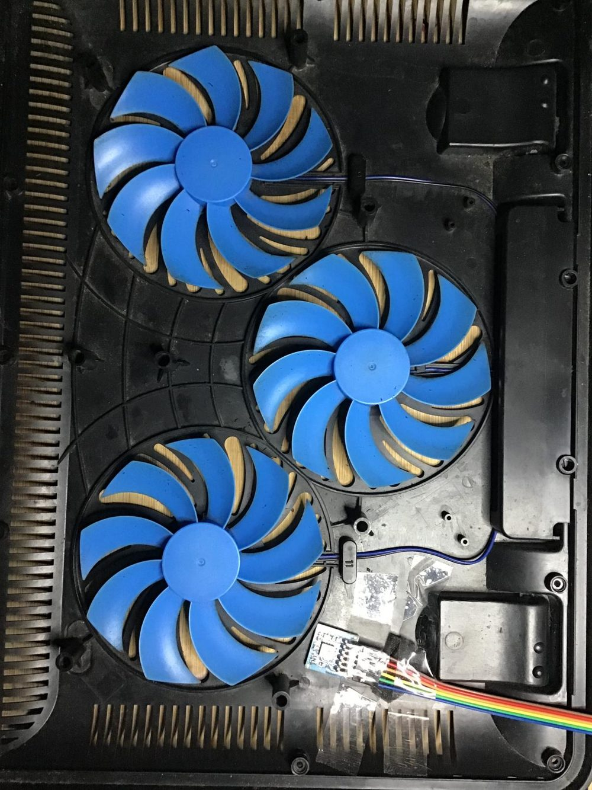
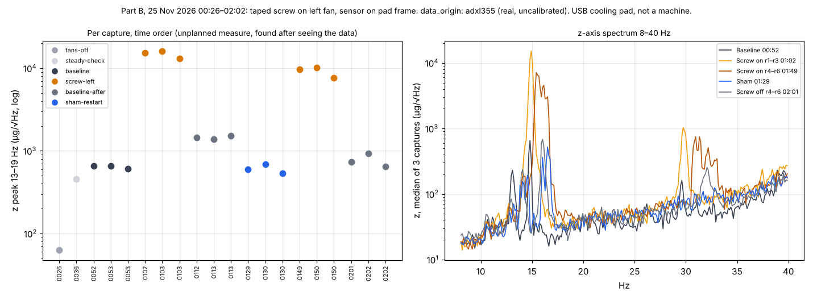

# Phase 1 results — sensor on the pad's frame (Part B), 25 November 2026, 00:26–02:02

**Data origin:** `adxl355`. Real measurements from the product sensor (EVAL-ADXL355-PMDZ on the ESP32-S3, about 4,010 Hz, ±2 g, uncalibrated: values in g good to about ±8 %). The test object is the Havit USB laptop cooling pad, **not an industrial machine**. This is one change (a taped screw) on one fan of one pad in one night. It is not evidence of fault detection on machines or of predictive maintenance.

**Plan followed:** `docs/PHASE1_NEXT_FAN_SESSION.md`, Part B, with Rami's decisions of 25 November: the 1× windows are not widened, TV and appliances are off, and both steady checks are taken. The rules were fixed before the data.
**Raw data:** `data/measured/adxl355/raw/20261125-0026…` to `20261125-0202…` (20 files), captured by Rami with `python/scripts/capture_adxl355.py`, mount tag `frame-left`.
**Analysis:** by Claude in a Linux cloud container, with the PR #9 script (`python/scripts/weight_test.py`, commit fda8330) unchanged, plus the plan's rub guard (800–1500 Hz z above 1.5× the baseline block) and bump check (kurtosis above 5).

## Setup

Pad on the bamboo board with the cover off. Sensor taped flat on the solid plastic frame beside the left fan (bottom fan in the photo, the one with the cable clip marked "11"), connector end toward the pad's edge. The ribbon cable is taped along the frame, away from all fans. Rami confirmed this is the same left fan that carried the screw on 24 November. After the photo, the chip end was also taped and the sensor was moved about 5 mm off the fan's ring, as advised.

**Mount check, fans off (00:26):** every check in `analyze_adxl355.py` PASSES. 0 missing sets, 0 CRC errors, 4,009.9 Hz, |g| 0.996 (sensor flat, tilted about 3°), noise 12.5 / 11.9 / 16.4 µg/√Hz on x / y / z.

## Result by the pre-set rules: INCONCLUSIVE (and NOT DETECTED by the planned measure)

| Block | Time | 1× y (script) µg/√Hz | 800–1500 Hz z, median of 1 s | Kurtosis |
| --- | --- | --- | --- | --- |
| Baseline r1–r3 | 00:52–00:53 | 22, 24, 21 | 4.07–4.14 mg | 3.5–3.6 |
| Screw on, round 1, r1–r3 | 01:02–01:03 | **99, 90, 89** | 4.86–4.97 mg (1.2×) | 3.1–3.2 |
| Screw off, round 1, r1–r3 | 01:12–01:13 | **185**, 28, **123** | 5.88–5.98 mg | 3.0–3.1 |
| Sham restart r1–r3 | 01:29–01:30 | 20, 21, 19 | 4.78–5.09 mg | 3.3–3.4 |
| Screw on, round 2, r4–r6 | 01:49–01:50 | **20, 20, 21** | 6.08–6.36 mg (1.48–**1.54×**) | 3.2–3.4 |
| Screw off, round 2, r4–r6 | 02:01–02:02 | 18, 20, 20 | 4.49–4.53 mg | 3.2–3.5 |

All 20 captures: 0 missing sets, 0 CRC errors, 0 restarts. No bumps (kurtosis ≤ 5 everywhere).

- **Rub guard:** screw-on r6 reached 1.54× the baseline's 800–1500 Hz level, above the 1.5× limit (r4 1.50×, r5 1.48×). It was not caught during the session, so it was not fixed. By the plan, round 2 does not count and the outcome is **Inconclusive**. The rise is steady, not knocks (kurtosis 3.2–3.4), and unweighted captures also reached 1.45× (round 1 screw-off). So it may not be a rub, but the rule is applied as written.
- **Planned 1× measure (script):** round 1 screw-on passes (89–99 ≥ 66). Round 2 screw-on fails (20–21). Two round 1 screw-off captures stay above 66 (185, 123: a line at 18.4 Hz). Verdict `NOT DETECTED`.
- **Sham:** no sham capture reaches 66.

## What the data shows beyond the verdict (found after seeing the data: leads, not results)

1. **A line at 14.7–17 Hz grows strongly with the screw, in all 6 screw-on captures.** On z (µg/√Hz, peak 13–19 Hz):

   | Baseline | Screw on r1–r3 | Screw off r1–r3 | Sham | Screw on r4–r6 | Screw off r4–r6 |
   | --- | --- | --- | --- | --- | --- |
   | 609–659 @ 14.8 Hz | **13,055–16,177** @ 14.7–14.9 | 1,386–1,527 @ 18.2–18.4 | 536–686 @ 15.9–17.1 | **7,683–10,239** @ 15.4–17.0 | 644–935 @ 15.9–16.2 |

   Against the baseline median (653), the screw-on captures are 12–25×. Every no-screw capture after the baseline is 0.8–2.3×. The same pattern shows on x and y (y: 1,136–2,221 with the screw, 50–199 without). It also has a 2× line (29.6–32 Hz) that grows with the screw. The script never sees it, because it looks for fan speeds only in 18–32 Hz.
   *If* this had been the planned measure, it would meet the confirm rule's shape (every screw-on ≥ 3×, every later no-screw < 3×). It was not planned: it was found after the data was seen, so it counts only as a lead for the next run.
2. **What the 15 Hz line is, is not established.** It has no line at 9× (blade pass), so it is not obviously a fan turning at 15 Hz. One reading fits the numbers: the screwed fan turns at about 29.7–32 Hz, and the screw makes the pad respond at **half** that speed as well, as a loose or rocking part does (the pad on its rubber feet, or the taped sensor). That is a hypothesis.
3. **Why round 2 failed the planned measure (likely, not proven):** in round 2 the strongest screw-on lines sit at 15.4–17 Hz and 30–32 Hz, which suggests the screwed fan ran faster than in round 1. The script tracked only one fan speed in that block (28.4 Hz), so its ±0.3 Hz window missed the screwed fan's line. With the sensor on the frame, the fan-speed tracker found 1–3 fans per block instead of 3, so it is less reliable on this mount.
4. **Round 1 screw-off had a line at 18.2–18.4 Hz** (z 1,386–1,527) that is in no other block. Cause unknown: possibly a fan running slow after the restart (the 24 Nov morning had a loose fan connector), or something left on a blade. It was gone by the sham.
5. **The high band is about 14× higher on the frame than beside the pad** (4.1 mg against 0.29 mg with fans off), as expected with the sensor on the vibrating structure itself.
6. **Steady check:** only the 5-minute capture was taken again. Baseline blade-pass lines held within 0.2 % across r1–r3.

## What this means

With the sensor on the frame, the screw produces a much larger change than beside the pad. In all 6 screw-on captures a low line (15–17 Hz) is 12–25× its baseline level. Beside the pad, the planned 1× measure reached at most 4×, and only in some captures. But the planned measure and the rub guard do not pass, so by the rules written beforehand this session is **inconclusive**. A fresh session with the 15–17 Hz feature (and its 2× line) written down **before** the data is needed to call it confirmed.

Nothing here shows that this works on an industrial machine, or that it predicts anything.

## Proposed next step (not done, needs Rami's OK)

Same Part B protocol on the frame mount, with these rules written before the data:
- **Measure:** the z peak in 13–19 Hz and in 26–34 Hz (the "half" and "1×" bands).
- **Confirmed** if every screw-on capture is ≥ 3× the baseline median in the 13–19 Hz band, and every later no-screw capture is < 3×.
- **Rub guard and bumps:** as before.
- **Live check:** Claude checks each block's rub level during the session, so a tripped guard can be fixed at once.
- **Extra control (optional, 10 min):** fans off, tap the pad's corner lightly. This shows whether the pad has a rocking resonance near 15 Hz.
