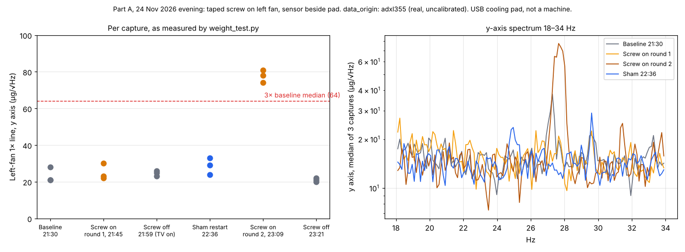

# Phase 1 results — left-fan screw confirmation (Part A), 24 November 2026, evening

**Data origin:** `adxl355`. Real measurements from the product sensor (EVAL-ADXL355-PMDZ on the ESP32-S3, about 4,009.5 Hz, ±2 g, uncalibrated: values in g good to about ±8 %). The test object is the Havit USB laptop cooling pad, **not an industrial machine**. This is one change (a taped screw) on one fan of one pad in one evening. It is not evidence of fault detection on machines or of predictive maintenance.

**Plan followed:** `docs/PHASE1_NEXT_FAN_SESSION.md`, Part A. The rules were fixed before the data.
**Raw data:** `data/measured/adxl355/raw/20261124-21*` to `20261124-23*` (19 files), captured by Rami from 21:16 to 23:23 America/Toronto with `python/scripts/capture_adxl355.py`.
**Analysis:** by Claude in a Linux cloud container, with the analysis script from PR #9 (`python/scripts/weight_test.py`, commit fda8330), unchanged, plus the extra checks named in the plan: kurtosis of 800–1500 Hz for bumps, and a fixed-band look at the spectrum for comparison.
**Setup:** sensor taped on the bamboo board about 1 cm from the pad (mount tag `board-beside`), cover off, the same as the morning of 24 November. Taped screw on the **left fan** (the one nearest the sensor), at the same spot on the blade as at 11:43. The pad was unplugged at its USB plug for every change, with a 5-minute wait after each plug-in.

## Result: NOT CONFIRMED

| Block | Time | Condition | Left-fan 1×, y (script) µg/√Hz | Fixed band 25–29 Hz, y: peak µg/√Hz @ Hz | 800–1500 Hz z (median of 1 s) | Kurtosis 800–1500 Hz |
| --- | --- | --- | --- | --- | --- | --- |
| Warm-up | 21:16 | steady-check, 5 min after plug-in | (not part of the rule) | 41 @ 26.8 | 0.38 mg | 3.5 |
| A0 | 21:30–21:31 | baseline | 21, 21, 28 | 38 @ 27.0–27.3 (all 3) | 0.35 mg | 3.0 |
| B1 | 21:45–21:46 | screw-left r1–r3 | **23, 22, 30** | 21–30 | 0.35–0.38 mg | 3.0–3.2 |
| A1 | 21:59–22:00 | baseline-after r1–r3 (**TV on**) | 26, 23, 25 | 18–24 | **5.5–7.5 mg** | 3.3–3.4 |
| S | 22:36–22:37 | sham-restart r1–r3 | 33, 24, 29 | 21–27 | 0.33 mg | 3.2 |
| B2 | 23:09–23:11 | screw-left r4–r6 | **74, 81, 78** | **74–100 @ 27.5–27.8** | 0.33 mg | 3.0–3.1 |
| A2 | 23:21–23:23 | baseline-after r4–r6 (**dishwasher started**) | 22, 21, 20 | 18–21 | 2.4–2.5 mg | 3.5–3.7 |

Data path: 0 missing sets, 0 CRC errors and 0 restarts in all 19 captures. No capture is bumped (kurtosis ≤ 5 in all of them), so none was excluded.

**Applying the rule as written.** The threshold is 3× the baseline median: 3 × 21 = 64 µg/√Hz.
- Screw-on captures: round 2 passes (74, 81, 78). **Round 1 fails** (23, 22, 30). The rule needs every one, so the outcome is **Not confirmed**.
- Screw-off and sham captures: all below 64 (20–33). That part passes.
- Sham check: no sham capture reaches 64, so a restart alone did not create the line. The result is not Inconclusive.
- Rub guard: no screw-on capture has 800–1500 Hz above 1.5× the baseline (0.33–0.38 mg against 0.35 mg).

The script (PR #9) gives the same verdict: `IMBALANCE (1x) VERDICT: NOT DETECTED`, failing on the three round 1 captures.

## What the data shows beyond the verdict

- **The two screw-on rounds disagree.** In round 1 the screw changed nothing visible at the left fan's 1×, on y or on z. In round 2 a line at 27.5–27.8 Hz appeared in all three captures and was gone when the screw came off. On the morning of 24 November, 2 of 3 screw captures showed a line, at 26.3–26.5 Hz. So the screw sometimes shows and sometimes does not, with the same fan, screw and mount.
- **The baseline already had a line near 27 Hz.** The fixed-band view shows about 38 µg/√Hz at 27.0–27.3 Hz in all three baseline captures. The script's 1× windows (±0.3 Hz around the tracked fan speeds, 26.22 and 29.73 Hz in that block) do not cover it. Measured against that line, round 2's rise is 1.9–2.6×, not 3.5–3.9×. Whether the round 2 line is that same baseline line grown and shifted up by 0.5 Hz, or a different fan's line, cannot be told from these captures. The rule uses the script's measure, so the verdict stands, but this needs a decision before the next session (see below).
- **Possible cause of the difference between rounds (a hypothesis, not tested):** the line's strength depends on where the fan's 1× sits relative to the board's resonances. Fan speed shifts 1–3 % on every restart. The screw-on line was at 26.3–26.5 Hz in the morning and at 27.5–27.8 Hz in round 2. A fan turning at a slightly different speed may put its 1× on or off a resonance. That is the same effect the 23 November warm-up run showed for the blade-pass lines.
- **Household sources raised the high band.** The 800–1500 Hz level was 16–21× normal in the round 1 screw-off captures. Rami confirmed the TV was on at 21:59–22:00 and off by 22:36. It was raised again (about 7×) at 23:21–23:23, when Rami says the dishwasher had started (his message at 23:26). The spectrum shows narrow lines at 947–951 Hz and an envelope that repeats at about 59.3 Hz. Neither touches the decision, which uses the ~26–28 Hz line, and the 0–100 Hz band rose by 1.1–1.9× at most. The kurtosis stayed at 3.3–3.7, so it is steady sound, not knocks. **Rule for the next session: TV, dishwasher and washer off for the whole session.**
- **Steady check:** only the 5-minute capture was taken (the 15-minute one was skipped). At 5 minutes the fan lines were still smeared, as expected while the fans warm. In the three baseline captures, about 19 minutes after plug-in, the blade-pass line near 237–238 Hz held within 0.3 %.

## What this means

With the sensor beside the pad, a taped screw on the nearest fan is **sometimes** visible at that fan's 1× and **sometimes not**. Over the two sessions it showed in 5 of 9 screw-on captures. When it does show, it goes away when the screw is removed, and a sham restart does not produce it. This is not reliable enough to call detection, and the pre-set rule says so.

This is the result Part B was planned for: mount the sensor on the pad's frame, closer to the fan's own structure, and see whether the line becomes consistent.

## Decisions before Part B (for Rami)

1. **The baseline line at about 27.3 Hz.** Keep the script's tracked 1× windows as the decision measure (as now), or widen them so that a fan line in the baseline near the screw-on frequency is always included? Widening makes the test stricter. Either choice has to be made before Part B's data.
2. **TV off and no dishwasher or washer running** for the whole session (proposed above). Both raised the 800–1500 Hz band tonight, and a washer spin showed up at 20.2 Hz in Phase 0b.
3. **Take the 15-minute steady check** this time. It costs 10 minutes.
