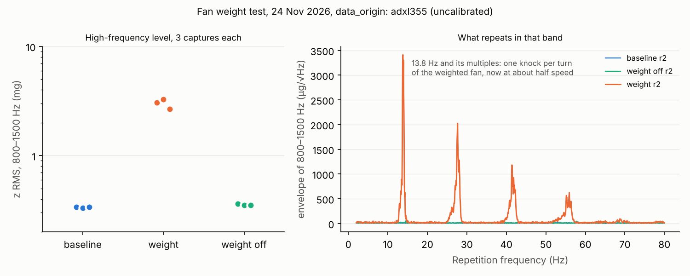

# Phase 1 results — fan weight test, 24 November 2026

**Data origin:** `adxl355`. Real measurements from the product sensor (EVAL-ADXL355-PMDZ on the ESP32-S3, 4,009.5 Hz, ±2 g, uncalibrated: values in g good to about ±8 %). The test object is the Havit USB laptop cooling pad, **not an industrial machine**. This is one deliberate change on one pad; it is not evidence of fault detection on machines or of predictive maintenance.

**Raw data:** `data/measured/adxl355/raw/20261124-07*_adxl355_{baseline,weight,baseline-after}_board-beside_r{1,2,3}.csv` (9 files), captured by Rami 07:11–07:44 America/Toronto.
**Analysis:** by Claude in a Linux cloud container with SciPy: band RMS from Welch spectra (65,536 points), and the envelope (Hilbert transform) of the 800–1500 Hz band to see what repeats in it.
**Setup:** same as `docs/PHASE1_FAN_RESULTS_2026-11-23.md` (sensor taped on the bamboo board about 1 cm from the pad, mount tag `board-beside`). Weight: to be recorded (which fan, what material).

## Plan and criterion (written before the data was seen)

Baseline ×3, weight on one blade tip of one fan ×3, weight removed ×3, 30 s each, pad running throughout except to add or remove the weight, 3 minutes' wait after each change. The weight counts as detected only if the weighted fan's 1× line, or another of its lines, changes more from baseline to weight than it differs between baseline and baseline-after.

## Summary

| Question | Answer |
| --- | --- |
| Clean data? | **Yes.** 0 missing sets, 0 CRC errors, 0 overruns, 0 dropped words, 0 SPI errors in all 9 captures. 22.1–22.7 °C. |
| Did the weight change the vibration? | **Yes, strongly, in all 3 weighted captures**, and it went back to normal when the weight was removed. |
| Was it the expected imbalance signature (a bigger 1× line at normal speed)? | **No.** The weighted fan dropped to about **half speed** (13.5–13.8 Hz in r1–r2, 11.7 Hz in r3, normal is 23–28 Hz) and **knocked once per turn**. That is a rub or a braked fan, not a pure imbalance. |
| Does it pass the criterion? | **Yes**: the weighted fan's lines moved to a new speed, and its once-per-turn knocks appear in all 3 weighted captures and in none of the 6 others. The features that showed it (below) were chosen after looking at the data, so they need confirming on a fresh run. |

## What changed

| Feature (z axis) | Baseline r1–r3 | Weight r1–r3 | Weight off r1–r3 |
| --- | --- | --- | --- |
| RMS 800–1500 Hz | 0.33–0.34 mg | 2.67–3.27 mg | 0.35–0.36 mg |
| Kurtosis of 800–1500 Hz (3 = steady noise, higher = knocks) | 2.9–3.0 | 4.3–6.3 | 3.0–3.1 |
| Strongest repetition in that band (envelope) | none above 9× the floor (x, y, z) | 13.5, 13.8, 11.7 Hz, 60–90× the floor, with multiples | none above 9× the floor (x, y, z) |
| RMS 80–800 Hz | 6.9–7.6 mg | 12.5–13.0 mg | 7.4–7.5 mg |

x and y show the same: 800–1500 Hz rises 5–6× (x) and 12–18× (y) with the weight and returns to baseline without it.

- **Speed of the weighted fan:** the knock rate equals a new spectral line at the same frequency (13.8 Hz, 150–310 µg/√Hz on z) and a line at 9× it (121–124 Hz in r1–r2, 104.7 Hz in r3): a fan turning at 13.5–13.8 then 11.7 turns per second. It slowed further between r2 and r3, which suggests it was rubbing harder, not settling.
- **Normal-speed 1× lines:** the 22–28 Hz band is unchanged on all axes (0.03–0.09 mg in every capture).
- **Fixed bands around the fan lines are not reliable on their own:** baseline and baseline-after differ by up to 5× in some bands (z 135–185 Hz: 3.6–4.1 mg vs 0.73–0.75 mg) because the fans' speeds and line positions differ between the two (as seen in the warm-up run). The 800–1500 Hz level, its kurtosis and its envelope stayed within 10 % between baseline and baseline-after.

## What this means

- The ADXL355 setup detects a **rubbing or braked fan** easily and repeatably, and shows which speed it runs at. That is a real fault type on machines (rub), but this test used one pad, one weight and one session.
- **Imbalance (1× at normal speed) is still untested**: the weight was large enough, or placed so, that it slowed the fan and made it knock. A pure imbalance test needs a smaller weight that does not touch anything and does not change the fan's sound or speed.
- Features that worked here: high-frequency RMS, kurtosis, and the envelope's repetition rate. Features that need care: fixed frequency bands near the fan lines (they move with fan speed).

## Suggested next test (not done)

Same A-B-A plan with a much smaller weight (a single small piece of tape, folded once), checked by eye and ear to spin freely at normal speed. Before the data: the new run passes if the weighted fan's 1× line at its normal speed grows more than its baseline vs baseline-after spread, with the high-frequency level unchanged (no rub).
