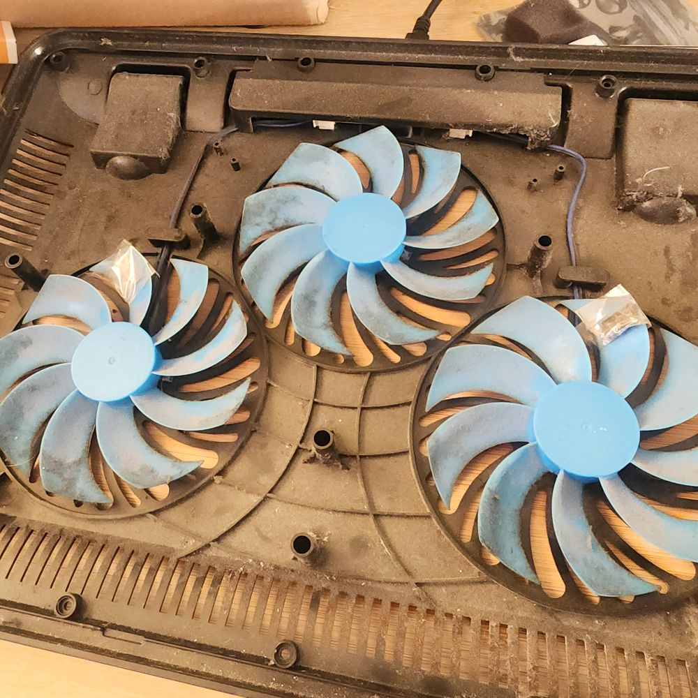
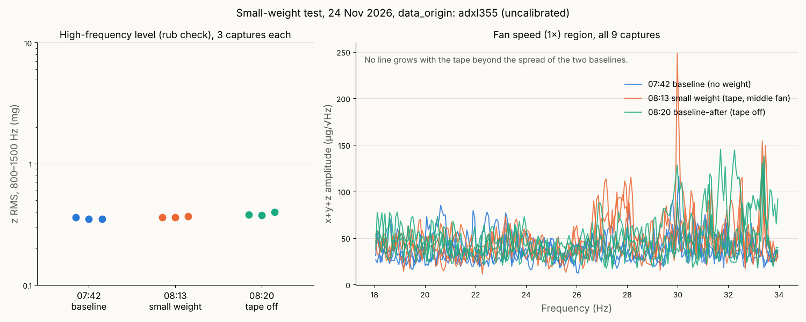
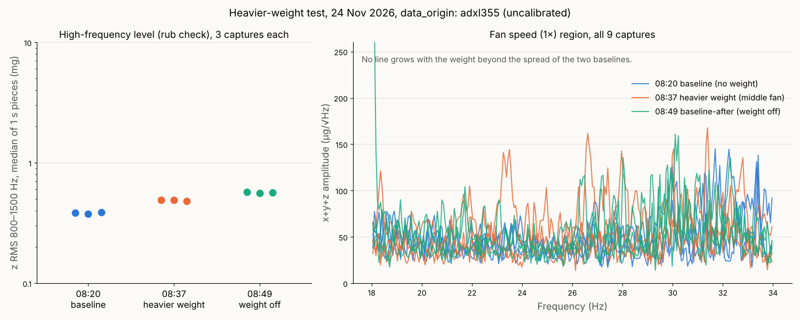
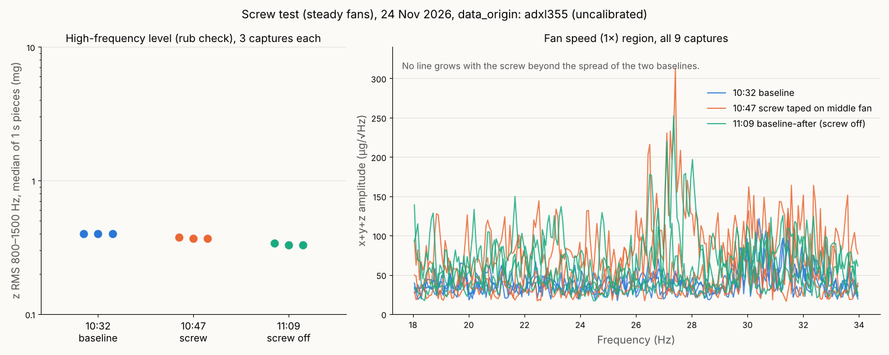

# Phase 1 results — fan weight test, 24 November 2026

**Data origin:** `adxl355`. Real measurements from the product sensor (EVAL-ADXL355-PMDZ on the ESP32-S3, 4,009.5 Hz, ±2 g, uncalibrated: values in g good to about ±8 %). The test object is the Havit USB laptop cooling pad, **not an industrial machine**. This is one deliberate change on one pad; it is not evidence of fault detection on machines or of predictive maintenance.

**Raw data:** `data/measured/adxl355/raw/20261124-07*_adxl355_{baseline,weight,baseline-after}_board-beside_r{1,2,3}.csv` (9 files), captured by Rami 07:11–07:44 America/Toronto.
**Analysis:** by Claude in a Linux cloud container with SciPy: band RMS from Welch spectra (65,536 points); the 800–1500 Hz level and kurtosis from a 4th-order band-pass filter with the first 0.5 s skipped; and the envelope (Hilbert transform) of the 800–1500 Hz band to see what repeats in it.
**Setup:** same as `docs/PHASE1_FAN_RESULTS_2026-11-23.md` (sensor taped on the bamboo board about 1 cm from the pad, mount tag `board-beside`). Weight (from Rami's photo taken 07:36, between the last weighted capture and the removal): **two fans were weighted, not one.** The pad's bottom cover is off, and the left and right fans (as seen in the photo) each carry a small clear plastic bag, with something inside, tucked at one blade. Contents, and whether the cover was off for all 9 captures, to be recorded.

## Plan and criterion (written before the data was seen)

Baseline ×3, weight on one blade tip of one fan ×3, weight removed ×3, 30 s each, pad running throughout except to add or remove the weight, 3 minutes' wait after each change. The weight counts as detected only if the weighted fan's 1× line, or another of its lines, changes more from baseline to weight than it differs between baseline and baseline-after.

## Summary

| Question | Answer |
| --- | --- |
| Clean data? | **Yes.** 0 missing sets, 0 CRC errors, 0 overruns, 0 dropped words, 0 SPI errors in all 9 captures. 22.1–22.7 °C. |
| Did the weight change the vibration? | **Yes, strongly, in all 3 weighted captures**, and it went back to normal when the weight was removed. |
| Was it the expected imbalance signature (a bigger 1× line at normal speed)? | **No.** The high-frequency band **knocked at a steady rate**: 13.7–13.8 times a second in r1–r2 and 11.75 in r3. That looks like a rub (a bag touching the frame), not a pure imbalance. Which fan knocked, and at what speed it turned, is **not established** (see the correction below). |
| Does it pass the criterion? | **Yes**: the knocks appear in all 3 weighted captures and in none of the 6 others. The features that showed it (below) were chosen after looking at the data, so they need confirming on a fresh run. |

## What changed

| Feature (z axis) | Baseline r1–r3 | Weight r1–r3 | Weight off r1–r3 |
| --- | --- | --- | --- |
| RMS 800–1500 Hz | 0.33–0.34 mg | 2.67–3.27 mg | 0.35–0.36 mg |
| Kurtosis of 800–1500 Hz (3 = steady noise, higher = knocks) | 2.9–3.0 | 4.3–6.3 | 3.0–3.1 |
| Strongest repetition in that band (envelope) | none above 9× the floor (x, y, z) | 13.5, 13.8, 11.7 Hz, 60–90× the floor, with multiples | none above 9× the floor (x, y, z) |
| RMS 80–800 Hz | 6.9–7.6 mg | 12.5–13.0 mg | 7.4–7.5 mg |

x and y show the same: 800–1500 Hz rises 5–6× (x) and 12–18× (y) with the weight and returns to baseline without it.

- **Correction (24 Nov, 08:00): the knock rate is not shown to be a fan's speed.** The first version of this note said the knock rate matched a *new* spectral line at 13.8 Hz and a line at 9× it, so one fan had slowed to half speed. Rechecked on all 9 captures, both lines were already there before the weight:

  | Line (strongest axis) | Baseline r1–r3 | Weight r1–r3 | Weight off r1–r3 |
  | --- | --- | --- | --- |
  | 13–15 Hz, y | 13.9 Hz, 1.9–2.1 mg/√Hz | 13.6–14.0 Hz, 1.1–2.3 mg/√Hz | 14.5 Hz, 1.4 mg/√Hz |
  | 118–128 Hz, z | 125 Hz, 0.27–0.31 mg/√Hz | 122–128 Hz, 0.28–0.49 mg/√Hz | 124–126 Hz, 0.04–0.05 mg/√Hz |

  The 13–15 Hz y line also appears in the 23 November fans-on captures (12.6–13.8 Hz, rising as the fans warm) and not with the fans off, so it comes from the fans, but what it is (a slow fan, or a half-order line of a normal one) is open. What stays: the knocks themselves are new and repeat at 13.7, 13.8 and 11.75 Hz with multiples (envelope, 0.12 Hz resolution), in r3 clearly away from the 13.6 Hz line. In r1–r2 the x and z envelopes also show a weaker second rate (12.9–13.2 Hz), which would fit two weighted fans, but that is not proven.
- **Normal-speed 1× lines:** the 22–28 Hz band is unchanged on all axes (0.03–0.09 mg in every capture).
- **Fixed bands around the fan lines are not reliable on their own:** baseline and baseline-after differ by up to 5× in some bands (z 135–185 Hz: 3.6–4.1 mg vs 0.73–0.75 mg) because the fans' speeds and line positions differ between the two (as seen in the warm-up run). The 800–1500 Hz level, its kurtosis and its envelope stayed within 10 % between baseline and baseline-after.

## What this means

- The ADXL355 setup detects a **rubbing or braked fan** easily and repeatably. That is a real fault type on machines (rub), but this test used one pad, two weights placed at once, and one session.
- **Imbalance (1× at normal speed) is still untested**: the weights were large enough, or placed so, that something knocked. A pure imbalance test needs a smaller weight that does not touch anything and does not change the fan's sound or speed.
- Features that worked here: high-frequency RMS, kurtosis, and the envelope's repetition rate. Features that need care: fixed frequency bands near the fan lines (they move with fan speed).

## Suggested next test (done at 08:13, see below)

Same A-B-A plan with **one** fan weighted, cover on as in normal use, and a much smaller weight (a single small piece of tape, folded once), checked by eye and ear to spin freely at normal speed. Before the data: the new run passes if the weighted fan's 1× line at its normal speed grows more than its baseline vs baseline-after spread, with the high-frequency level unchanged (no rub).

## Weights used in the first test

Rami's photo at 07:58 shows the two objects that were in the bags: a clear dome about 1 cm across and a strip of black foam with a short bent wire (red insulation). Which object was on which fan is not recorded.

# Small-weight test, same morning (08:13–08:21)

**Data origin:** `adxl355`, same sensor, mount (`board-beside`) and pad as above, bottom cover off throughout. USB cooling pad, **not an industrial machine**.

**Raw data:** `20261124-0813..0814_adxl355_small-weight_board-beside_r{1,2,3}.csv` and `20261124-0820..0821_adxl355_baseline-after_board-beside_r{1,2,3}.csv`. The 07:42–07:44 baseline-after captures of the first test serve as this test's baseline (Rami had already put the tape on, so the baseline was not repeated).

**Weight:** a piece of tape, about 2 × 1 cm folded once, flat on the top face of one blade of the **middle fan**, about halfway out. Pad unplugged to add and remove it, then 3 minutes running before capturing.

**Criterion (written before the data):** detected only if the middle fan's 1× line grows more from baseline to tape than it differs between the two baselines, with the 800–1500 Hz level within 1.5× of baseline (no rub).

| | 07:42 baseline r1–r3 | 08:13 tape r1–r3 | 08:20 tape off r1–r3 |
| --- | --- | --- | --- |
| Data path | 0 missing, 0 CRC, 0 overruns | same | same |
| z RMS 800–1500 Hz | 0.35–0.36 mg | 0.36–0.37 mg | 0.38–0.40 mg |
| Kurtosis, 800–1500 Hz | 3.0 | 3.0 | 3.0, 3.0, 4.4 |
| Strongest lines 22–31 Hz (x+y+z, µg/√Hz) | 55–116 | 63–248 | 55–128 |
| Blade-pass lines (9×) | 231–233, 254 Hz | 233–274 Hz | 224, 240–242, 262–264 Hz |

## Result: not detected

- **No rub:** the 800–1500 Hz level with the tape is the same as both baselines.
- **No 1× growth beyond the normal spread.** Lines in 22–31 Hz are 2–5× the floor in every capture, with and without tape. The highest single value (248 µg/√Hz at 30.0 Hz, tape r1) sits at a frequency that also peaks without the tape (128 at 30.0 Hz, 08:21 r2) and does not match any fan's blade-pass ÷ 9. Which line is the middle fan's could not be told apart.
- **Session drift is larger than the tape:** fan blade-pass lines moved from 231–233/254 Hz at 07:42 to 240–242/262–264 Hz at 08:20 (about +4 %), with no weight on.
- One tape-off capture (08:21 r3) has kurtosis 4.4, a few knocks or a bump; it does not change the result.

## What this means

The tape-sized imbalance on one fan of this pad is **not visible** with the sensor beside the pad: the fans' 1× lines are close to the floor and they wander more between captures than the tape could change them. This is consistent with Phase 0b (no 1× seen with the phone). A rub, as in the first test, is visible; a small imbalance on this fan, at this distance, is not.

Options if imbalance is to be tested further (none done): sensor on the pad's frame instead of beside it, a heavier weight that still spins freely, or a rig with a stiffer, slower rotor than a USB fan.

# Heavier-weight test, same morning (08:37–08:50)

**Data origin:** `adxl355`, same sensor, mount, pad and cover-off state. USB cooling pad, **not an industrial machine**.

**Raw data:** `20261124-0837..0838_adxl355_medium-weight_board-beside_r{1,2,3}.csv` and `20261124-0849..0850_adxl355_baseline-after_board-beside_r{1,2,3}.csv`. Baseline: the 08:20–08:21 tape-off captures (Rami's choice). Weight: **a small screw** (Rami, 08:57; the capture note still holds the placeholder text). Same fan (middle) and position as the tape.

**Criterion:** same as the small-weight test, written before the data.

| | 08:20 baseline r1–r3 | 08:37 weight r1–r3 | 08:49 weight off r1–r3 |
| --- | --- | --- | --- |
| Data path | 0 missing, 0 CRC, 0 overruns | same | same |
| z 800–1500 Hz, median of 1 s pieces | 0.38–0.39 mg | 0.48–0.49 mg | 0.56–0.57 mg |
| Single bumps (one second > 2× the rest) | none | r3 at 26 s (24 mg peak) | r3 at 1 s (29 mg peak) |
| Strongest lines 22–31 Hz (x+y+z, µg/√Hz) | 55–128 | 69–162 | 66–161 |
| Blade-pass lines (9×) | 224, 240–242, 262–264 Hz | 227–229, 246–248 Hz | 210–216, 233–235, 248–255 Hz |
| Envelope repetition, 800–1500 Hz | none above 35× floor | none above 31× floor | none above 20× floor |

## Result: not detected

- **No 1× growth beyond the normal spread:** the highest lines with the weight (up to 162 µg/√Hz, r1 only) are matched by the weight-off captures (up to 161). r2 and r3 with the weight are no higher than the baseline.
- **No rub:** no repeating knocks (the first test's rub gave envelope lines thousands of times the floor). The high-frequency level rose 1.3× with the weight, within the 1.5× limit, but rose further (1.5×) after the weight was removed, so it is not caused by the weight.
- **The fans slowed through the session:** blade-pass lines fell about 5 % from 08:20 to 08:37 and about 5–10 % more by 08:50, with the weight already off. Something changed in the pad or its supply during this period; Rami suspects a fan connector inside the pad was not fully plugged in (possible, not confirmed). That drift is far larger than any 1× change.
- Two single bumps (one per capture, in r3 of the weight and weight-off sets) look like touches to the desk or board; they do not change the result.

## Where this leaves imbalance testing

Two weights on the middle fan (folded tape, then a small screw), neither detected with the sensor beside the pad; a rub (first test) is detected easily. The fans' own speed changes between captures (4–10 % within an hour) are the main obstacle. A further imbalance test should first fix that (speed steady for 10 minutes before the baseline, checked from the blade-pass lines) and move the sensor onto the pad's frame.

# Speed steadiness check after reseating the fan connectors (10:10–10:25)

**Data origin:** `adxl355`, same setup, no weight, cover off. Rami pressed the fan connectors in firmly before these captures. **Raw data:** `20261124-1010..1025_adxl355_steady-check_board-beside_r{1,2,3}.csv` (4 files: the 10:10 file was run with `--repeat 2` by mistake, so `r2` appears twice with different times).

**Criterion (written before the data):** blade-pass lines within 1 % over 10 minutes.

| Capture | 800–1500 Hz, z | Blade-pass lines (x+y+z), Hz |
| --- | --- | --- |
| 10:10 | 0.36 mg | 211.6, 224.9, 239.2, 264.5 |
| 10:11 | 0.36 mg | 210.8, 224.1, 239.1, 263.6 |
| 10:12 | 0.39 mg | 210.2, 223.4, 238.2, 262.7 |
| 10:25 | 0.41 mg | 209.9, 223.0, 236.7, 262.3 |

**Result: steady enough.** From 10:12 to 10:25 every line moved 0.6 % or less; from the very first capture (10:10) to 10:25, 0.8–1.0 %, most of it in the first two minutes. All captures clean (0 missing sets, 0 CRC errors). The high-frequency level is back near the 08:20 value (0.36–0.41 vs 0.57 mg at 08:50), which fits the loose-connector explanation but does not prove it. Rule for the next imbalance test: start the baseline only after the lines have held within 1 % for at least 10 minutes.

# Screw test with steady fans (10:32–11:10)

**Data origin:** `adxl355`, same setup, cover off, fan connectors reseated and speed checked steady beforehand. USB cooling pad, **not an industrial machine**. **Raw data:** `20261124-1032..1033_adxl355_baseline_*`, `20261124-1047..1048_adxl355_screw-weight_*`, `20261124-1109..1110_adxl355_baseline-after_*` (r1–r3 each). **Weight:** the same small screw, fully covered with tape, on the same spot of the middle fan; 5 minutes running after each plug-in.

**Criterion (written before the data):** detected only if a fan's 1× line grows more from baseline to screw than the two baselines differ, with 800–1500 Hz within 1.5× of baseline; **inconclusive** if the fan lines in the two baselines differ by more than 1 %.

| | 10:32 baseline r1–r3 | 10:47 screw r1–r3 | 11:09 screw off r1–r3 |
| --- | --- | --- | --- |
| Data path | 0 missing, 0 CRC, 0 overruns | same | same |
| z 800–1500 Hz, median of 1 s pieces | 0.40 mg | 0.37–0.38 mg | 0.33–0.34 mg |
| Kurtosis (bumps) | 2.9–3.0 | 11.7 (r1), 3.0, 3.0 | 4.4 (r1), 3.5, 3.0 |
| Blade-pass lines, Hz | 210–212, 222–223, 237–238, 263–264 | 213, 226–227, 239–240, 266–267 | 209–210, 230, 232–233, 261–262 |
| Strongest line 22–31 Hz (x+y+z, µg/√Hz) | 84–122 | 89–313 | 90–252 |

## Result: inconclusive by the pre-set rule, and not detected in any case

- **Baselines differ by more than 1 %:** two of the four blade-pass lines moved 2–3 % between the 10:32 and 11:09 baselines (222–223 → 230 Hz and 237–238 → 232–233 Hz), so by the rule set beforehand the test is inconclusive. Removing the screw and tape, or plugging in again, changed the fans' speeds.
- **No consistent 1× growth:** the highest line with the screw (313 µg/√Hz at 27.4 Hz) is in r1 only, which also has a bump (kurtosis 11.7) that raises the whole spectrum; r3 with the screw is no higher than the baseline. The screw-off r1 reaches 252 at the same frequency.
- **No rub:** 800–1500 Hz did not rise.

## Overall, imbalance on this pad (three attempts)

Folded tape, a small screw, and the screw again with steady fans: **none detected**. The fans' 1× lines sit near the noise floor with the sensor beside the pad, and the fans' speeds shift by 1–3 % whenever the pad is unplugged and restarted, which is about as large as any effect a small weight could have. A rub (first test) is detected easily. Further imbalance testing on this pad would need a different mount (sensor on the pad's frame) rather than more weight.
